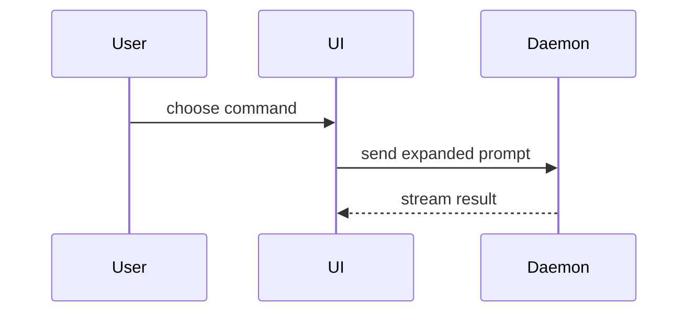

# Summary visuals

Adapted from Matt Pocock's `pr` skill (after Dex Horthy's `show-me`); see `../CREDITS.md`. Place each
visual next to the short text it supports.

Logic or an algorithm as pseudocode:

```text
on(save)
  if content is unchanged
    return cached result
  write new content
  return fresh result
```

Runtime control flow as a call tree:

```text
submitForm
  createSession
    persistPrompt
    launchAgent
  navigateToSession
```

UI structure as a component tree, with the state and module boundaries that matter:

```text
<SessionPage> (apps/example/src/routes/session.tsx)
  useSessionEvents()
  <SessionToolbar>
    <RunSkillButton> (packages/ui)
```

File responsibility or a broad refactor as a shallow file tree:

```text
src/
├── commands/       # parses user actions
├── sessions/       # owns session state
└── transport/      # sends API requests
```

Component interaction, control flow, or data flow with Mermaid:



Use `diff` when the point is what changes and the surrounding shape already
exists. Match the diff to the topic:

```diff
 <SessionPage>
   <SessionToolbar>
+    <RunSkillButton />
```

```diff
 src/
-└── transport.ts
+└── transport/
+    ├── client.ts
+    └── stream.ts
```

```diff
 submitForm
   createSession
+    expandSkillMention
     launchAgent
```

```diff
 on(save)
-  write content
+  if content is unchanged
+    return cached result
+  write new content
```

Show the whole block when most of it is new, when omitted context would hide
ownership or order, or when the reviewer needs a copyable target shape.
